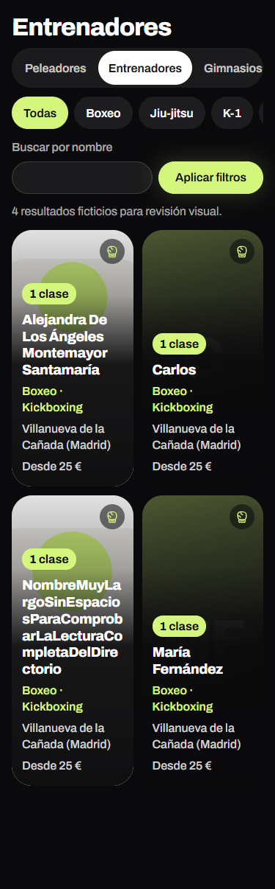
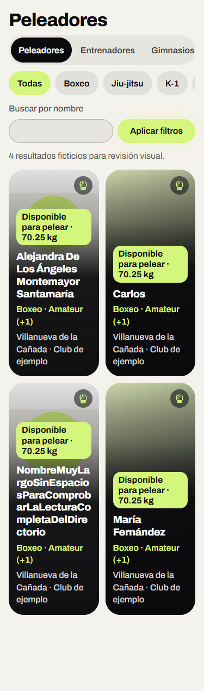
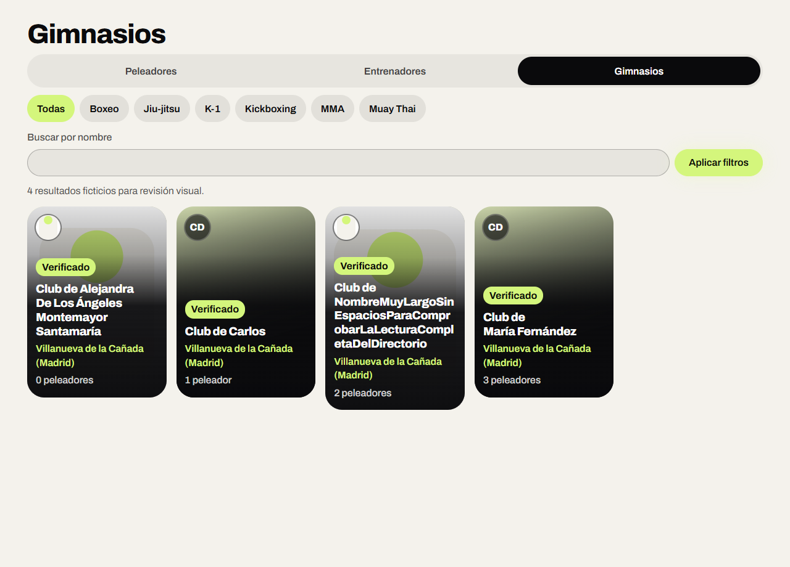

# Correcciones de los listados con foto

## Alcance

Rama propia desde `00038d6`, destinada a la rama de Claude del #97. Corrige los hallazgos de la revisión independiente: nombres y metadatos completos, texto principal de 16 px, navegación de 44 px y conservación de categoría/división al repetir disciplina. Mantiene la lista accesible de gimnasios y la prueba del mapa original.

## Comprobación

- Cinco regresiones específicas de filtros correctas y revisión Luna sin nuevos hallazgos en el cambio original `154563b`.
- Sobre esta rama: tipos y 915 pruebas unitarias correctos; versión 0.21.1, catálogo de 477 archivos y mapa comprobados. Documentación 33/34: EPERM de Windows al crear un enlace simbólico del caso del catálogo; prueba intacta para CI Linux.
- Banco visual: 36 casos de componentes reales, tres directorios, 375/1280 px, temas claro/oscuro y casos mixto/una tarjeta/vacío. Doce auditorías axe sin incidencias; sin desbordamiento, texto principal de al menos 16 px y navegación de 44 px. Confirmado después de incorporar ul/li de Claude. Fotos y datos sintéticos, sin base de datos, hidratación Next ni acciones reales.
- Compilación completa correcta (`BUILD_EXIT=0`). Revisión final de esta rama pendiente al redactar. Los recorridos completos de navegador corresponden al CI; Docker/PostgreSQL no son accesibles en este cliente.

## Capturas del banco de componentes

Estas imágenes muestran fotos y datos ficticios; no son capturas de cuentas reales ni una comprobación de los formularios completos.

## Método y siguiente paso

Skills leídas para esta tarea: animate, impeccable, animate-expo, motion-design y React best practices. animate-expo no se aplica al código web; el motor de contexto de impeccable no está disponible y se han usado sus referencias. El movimiento conserva las entradas y el pulsado existentes, sin añadir efectos frecuentes.

Después de #90 y #91, publicar el PR hacia la rama de Claude y responder a la revisión. El menú conserva su estructura; la propuesta de acceso directo a Entrenadores queda en IDEAS, pendiente de aprobación. Las mediciones de scroll y los rediseños guiados requieren capturas de las pantallas completas con una base de prueba accesible.
